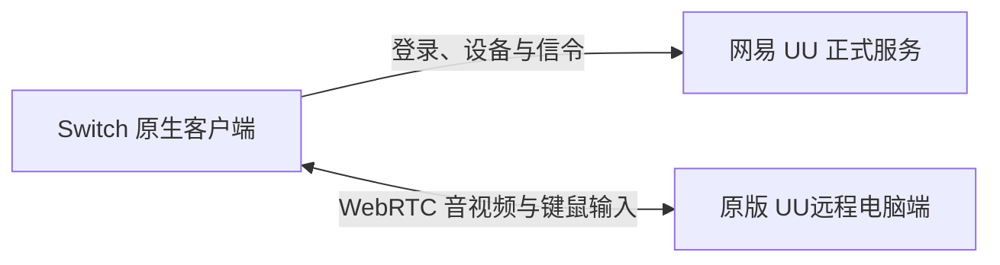

# UU Remote NS（Switch 高清修复分支）

**面向 Nintendo Switch 的原生 UU 远程主控端 —— 高清 / 高码率修复版。**

基于 C++17 / libnx 的非官方自制程序，独立连接网易 UU 正式服务与原版 UU远程电脑端，接收电脑画面和声音，并通过 Joy-Con 或触屏发送键鼠操作。运行时无需额外网关。

> ⚠️ **非官方项目**：与网易 UU、任天堂均无关联。本仓库**不包含**任何官方二进制、签名密钥或素材；
> 构建所需的签名常量需使用者自行从合法获得的官方 APK 中提取，本仓库也不提供预编译 NRO。
> 详见 [NOTICE.md](NOTICE.md)。


[](LICENSE)

[功能](#功能) · [高清修复说明](#高清修复说明) · [按键操作](#按键操作) · [源码构建](#源码构建) · [当前限制](#当前限制) · [English](README.en.md)

---

## 高清修复说明

上游版本在 Switch 真机上串流时存在**周期性花屏（竖线/彩块）、画面发糊、帧率从 60 掉到 33** 等问题。
本分支定位到根因并全部修复，实测 **4M / 8M / 20M @ 60fps 均清晰稳定**，接收端丢包为 0。

### 根因

**libnx 默认的 UDP 接收缓冲只有 `0xA500`（42,240 字节）。**视频按帧突发到达，网络线程稍有调度延迟
就会溢出丢包（实测固定 ~4-8%）。丢包进一步引发连锁反应：

1. 接收端 TWCC 反馈如实上报丢包 → 服务器 GCC 误判为网络拥塞 → 码率从 4~8 Mbps 压到 0.9 Mbps、帧率降到 33
2. 客户端每个缺口都请求整帧 IDR（实测 5 分钟 93 个）→ 关键帧吃掉 10~25% 码率 → 画质周期性下陷
3. 解码参考链断开 → 竖线 / 局部糊残留到下一个关键帧

### 修复内容

| 修复 | 说明 |
| --- | --- |
| **UDP 接收缓冲 42 KB → 256 KB** | `socketInitialize()` 时自定义 `udp_rx_buf_size`，申请失败自动回退默认值。**丢包归零的关键** |
| TWCC 反馈编码修正 | `reference time` 单位改为规范的 64 ms（原为 6.25 ms，差 10 倍导致码率崩到几百 kbps）；缺口按真实收发状态编码；批内到达时间按平滑包间隔锚定，消除突发锯齿 |
| 关键帧请求修复 | libdatachannel 的 `RtcpPli` 把 packet sender SSRC 填成对端媒体 SSRC，服务器直接无视。改为自建 `KeyframeRequestHandler`，用本端 SSRC 发 PLI + FIR；实测缺口到 IDR 的中位数 **1 ms** |
| 丢包不再触发降档 | 射频干扰型丢包不再上报给服务器速率控制器（RTCP RR 同步清零），避免"丢包→降码率→丢更多帧"的负循环 |
| NAL 扫描修正 | 一帧是 SPS + PPS + IDR 多个 NAL 拼接，原实现只看帧首 NAL，导致关键帧识别和冻结逻辑全部失效 |
| 解码器不 flush | 缺口时不再清空解码器参考帧（关键帧间隔长，flush 后满屏垃圾），改为冻结在最后一张好画面 + 立即请求 IDR |
| 帧节奏缓冲 | 解码后进入 2 帧小缓冲，按显示刷新节奏逐帧释放，网络突发不再造成"跳帧 + 卡顿"；改用共享帧指针，省掉每帧 3.7 MB 拷贝 |
| 诊断日志异步化 | 原实现在 RTP 接收线程同步 `fopen/fflush/fclose` 写 SD 卡（一次可达数十毫秒），直接阻塞收包。改为后台线程批量写；同时修复 128 KB 日志滚动卡死 |
| 本机光标 | 桌面捕获不到系统光标时，本地绘制标准箭头（白填充 + 黑描边） |

### 实测数据（Switch 掌机 / 5 GHz Wi-Fi）

| 项目 | 结果 |
| --- | --- |
| 链路吞吐（4 MB TCP） | **42 Mbps** |
| 4M / 8M / 20 Mbps @ 60fps | 清晰、无竖线，`lost=0` |
| 缺口 → 关键帧 | 中位数 1 ms，P90 27 ms |
| 解码队列溢出 | 0 |

---

## 功能

- **账号与设备**：大尺寸二维码或短信验证码登录，同步账号下的电脑，选择在线设备连接。
- **画面与声音**：原生 WebRTC 接收 H.264 / Opus；视频优先 NVDEC 硬解，失败回退软件解码。
- **画质**：L 键切换 流畅 / 高清 / 超清 / 原画 / 自动 / 自定义，自定义档用 ZR/ZL 调 1~20 Mbps；R 键切换 30 / 60 fps。
- **Joy-Con 与触屏**：摇杆鼠标、左右键、滚轮、常用按键和触屏拖动。
- **会话管理**：取消连接、退出账号、连接异常提示，以及失焦或断开时尝试释放输入。
- **诊断**：连接过程与质量指标写入 SD 卡 `connection.log`（仅固定事件名与数值，不含凭据、地址、SDP 或数据通道内容）。

默认请求 **1280 × 720**。Joy-Con 使用键鼠映射，尚未实现 UU 原生虚拟 Xbox 手柄协议。

## 按键操作

| 场景 | 按键 | 行为 |
| --- | --- | --- |
| 首页 | ↑ / ↓ · A | 选择电脑 · 确认或扫码登录 |
| 未登录 / 扫码界面 | X | 切换扫码或短信登录 |
| 短信登录 | ↑ / ↓ · A | 选择输入项或按钮 · 输入或确认 |
| 已登录首页 | Y · X · + | 刷新设备 · 退出账号 · 退出程序 |
| 登录或连接中 | B / − | 取消 |
| 远程桌面 | 左摇杆 | 移动鼠标 |
| 远程桌面 | ZR / ZL | 鼠标左键 / 右键 |
| 远程桌面 | 触屏 | 移动鼠标，按住拖动；画面黑边不发送输入 |
| 远程桌面 | 右摇杆上下 | 滚轮 |
| 远程桌面 | A / B / X / Y | Enter / Esc / Space / Tab |
| 远程桌面 | ↑ / ↓ / ← / → | W / S / A / D |
| 远程桌面 | L / R | 切换画质 / 切换帧率 |
| 远程桌面 | + · − | 显示或隐藏操作说明 · 断开连接 |

## 安装使用

本仓库**不提供预编译 NRO**（构建产物会嵌入从 APK 提取的签名常量）。请按下方「源码构建」自行编译，
产物 `dist/switch/UURemote-ns/UURemote-ns.nro` 放到：

```text
SD 卡根目录/
└── switch/
    └── UURemote-ns/
        └── UURemote-ns.nro
```

运行步骤：

1. 在电脑上打开**原版 UU远程电脑端**，登录账号并保持在线。
2. Switch 上按住 **R** 启动一个游戏进入完整内存模式的 hbmenu，再打开 **UU Remote NS**（不支持相册小程序模式）。
3. 按 **A** 获取二维码，用手机官方 UU远程 App 扫码并确认；也可按 **X** 切换短信登录。
4. 选择列表中的在线电脑，按 **A** 连接；远程桌面中按 **−** 断开。

账号令牌、手机号和验证码只保存在内存，重启程序后需要重新登录。SD 卡保存随机生成的 `client-id`
与连接日志 `connection.log`。

## 当前限制

- **H.265 未启用**：服务器 SDP 接受 H.265，但实际仍下发 H.264（PT 96）。客户端已支持按实际 RTP
  payload type 自动切换 HEVC/H.264 解码，找到服务器端编码开关即可生效。
- **音频偶发断开**：极少数情况下音频中断，重新连接可恢复；日志标记 `aud-clear` 用于定位。
- 未实现应用列表与启动界面、剪贴板、文件传输；不支持 TURN TCP / TLS，没有自动重连。
- 未实现完整音频抖动缓冲与音画时钟同步。
- 零拷贝显示未实现：SDL（Switch 端口）不支持 NV12 纹理，硬件帧仍需 CPU 转 RGBA。

反馈问题时请附上 `switch/UURemote-ns/connection.log`。若程序崩溃，再提供对应 Atmosphère 崩溃报告；
原始崩溃报告可能含内存中的凭据，公开反馈前请先脱敏。

## 源码构建

### 获取源码

```sh
git clone https://github.com/xiefengdaxia/UURemote-ns-switch.git
cd UURemote-ns-switch
```

需要 **CMake 3.21+、Ninja、Python 3.12+** 和 devkitPro Switch 工具链。
构建时还需自行提供 **UU TV 3.5.0 APK**，用于提取该版本的请求签名材料；仓库不包含 APK 或签名常量。

### Windows

可用 Python **3.14+** 将锁定版本的工具链下载到项目内的 `.tools/`，无需安装到系统目录：

```powershell
python scripts/bootstrap_sdk.py
./scripts/build.ps1 -Apk 'C:\path\to\UURemote-TV-3.5.0.apk'
```

已有 devkitPro 时，设置 `$env:DEVKITPRO` 后直接运行第二条命令即可。`cmake`、`ninja` 和 `python`
需位于 PATH；构建脚本也会识别项目内已有的 `.tools/ninja/ninja.exe`。

### Linux / macOS

在已有 devkitPro 环境中安装 `switch-dev`、`switch-sdl2`、`switch-sdl2_ttf`、`switch-curl`、
`switch-ffmpeg` 和 `switch-libopus`，其余 portlibs 由包依赖带入。然后执行：

```sh
export DEVKITPRO=/opt/devkitpro
python3 scripts/fetch_deps.py
python3 scripts/patch_deps.py
python3 scripts/extract_key.py /absolute/path/to/UURemote-TV-3.5.0.apk
cmake -S . -B build-nx -G Ninja -DCMAKE_TOOLCHAIN_FILE=cmake/switch.cmake -DCMAKE_BUILD_TYPE=Release
cmake --build build-nx -j6
python3 scripts/package.py
```

已验证的交叉编译环境为 Windows、devkitA64 r30 / GCC 16.1.0、libnx 4.12.0；Linux / macOS 步骤尚未实测。

构建输出：

| 路径 | 内容 |
| --- | --- |
| `build-nx/UURemote-ns.nro` | Switch 可执行文件 |
| `dist/UURemote-ns-<version>-switch.zip` | SD 卡安装包、说明和许可证 |
| `dist/SHA256SUMS` | NRO 与安装包校验值 |

第三方源码版本与 SHA256 记录在 [sources.lock.json](scripts/sources.lock.json)，
Windows 工具链包记录在 [sdk-windows.lock.json](scripts/sdk-windows.lock.json)。
依赖下载到 `external/`，Horizon 平台补丁由 [patch_deps.py](scripts/patch_deps.py) 应用。

### 本机测试

以下测试使用**本机 C / C++ 编译器**，不需要 Switch、APK 或 UU 账号。
首次运行前，先在仓库根目录执行 `python scripts/fetch_deps.py` 下载源码依赖。

```sh
# 协议回归
cmake -S . -B build-protocol -G Ninja -DUU_CORE_ONLY=ON -DCMAKE_BUILD_TYPE=Release
cmake --build build-protocol
ctest --test-dir build-protocol --output-on-failure

# 原生 WebRTC 回环
cmake -S . -B build-rtc-test -G Ninja -DUU_RTC_TESTS=ON -DCMAKE_BUILD_TYPE=Release
cmake --build build-rtc-test
ctest --test-dir build-rtc-test --output-on-failure
```

回环测试仅使用本机两个原生对端，不连接正式 UU 房间，不能替代 Switch 与原版电脑端的兼容性验证。

### Windows 完整客户端调试（开发版）

源码支持在 Windows 上直接运行同一套客户端，便于调试实际登录、信令、媒体和连接清理。
工具链与依赖安装在 `.tools/native-sdk`，与 Switch SDK 分开；需要 Python 3.14+、CMake 和 Ninja。

```powershell
python scripts/bootstrap_native_sdk.py
./scripts/build-native.ps1 -Run
```

启动前需已有从参考 APK 提取的 `romfs/signing.key`；运行时默认使用 Windows 微软雅黑，也可通过 `UU_FONT` 指定字体文件。

按 Enter 确认、方向键选择电脑、Esc 返回、Y 刷新、F2 断开、F10 退出。

## 技术结构



客户端使用 libcurl 处理 HTTPS / TLS WebSocket，libdatachannel 及其依赖处理 WebRTC，
FFmpeg / Opus 负责解码，SDL2 负责显示与音频输出。中文使用系统共享字体。
协议移植参考 `UURemote-web`，保留其已验证的请求签名、连接参数及信令封装。

实现细节、源码位置与真机检查步骤见 [开发记录](docs/development.md)。

## 许可证与声明

项目代码采用 [GPL-3.0-or-later](LICENSE)，依赖的授权信息见 [THIRD_PARTY.md](THIRD_PARTY.md)，
非官方与商标声明见 [NOTICE.md](NOTICE.md)。

签名材料在本机构建时从用户提供的 APK 提取，写入被 Git 忽略的 `romfs/signing.key` 并嵌入生成的 NRO；
它不是能够在客户端保密的密钥。APK、UU 品牌和协议归原权利人所有。本项目非网易官方客户端，
与网易无隶属或背书关系，也不分发任何官方二进制或预编译发行物。

上游项目：<https://github.com/Antman2023/UURemote-ns>
